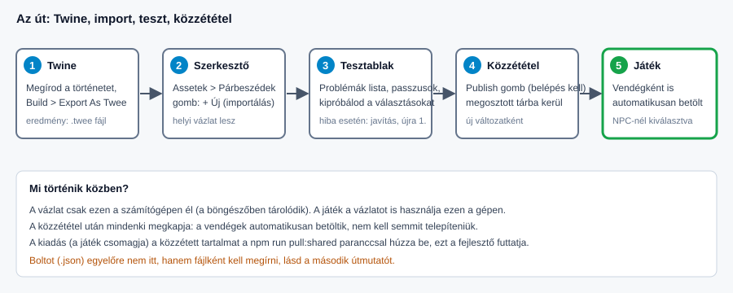
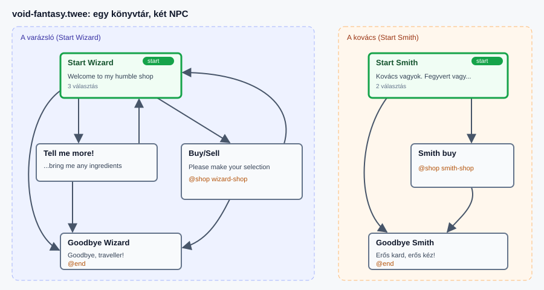
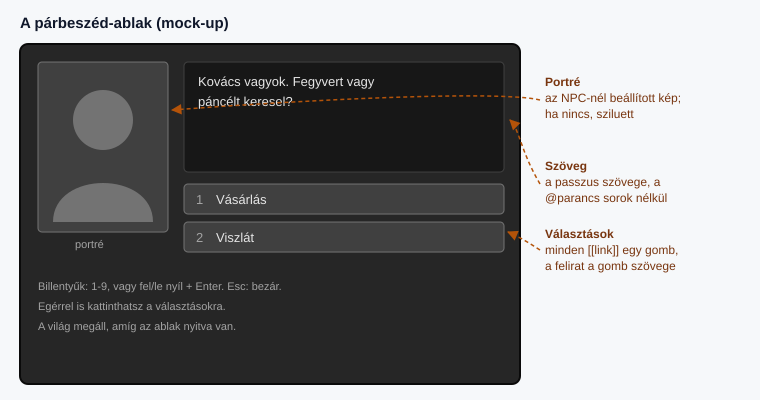
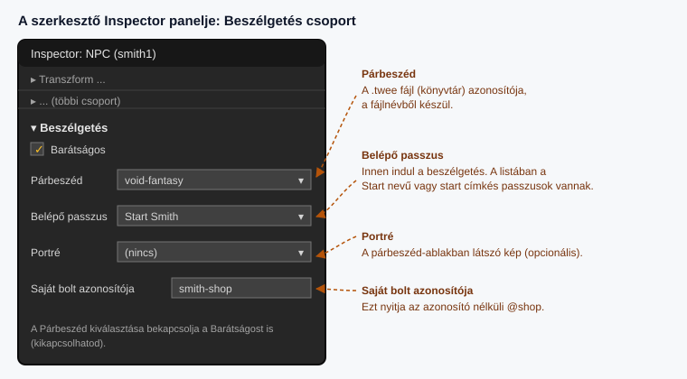
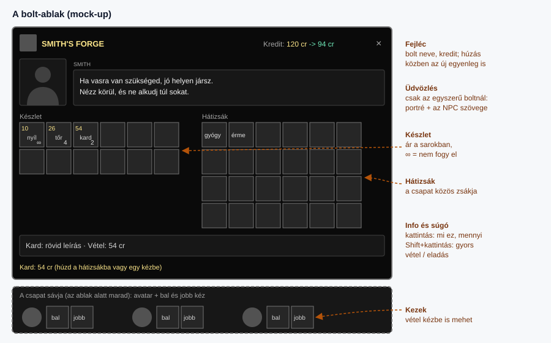

# Párbeszéd és bolt szerkesztő útmutató

Ez az útmutató megmutatja, hogyan lesz a Twine-ban írt történetből **NPC-beszélgetés és bolt** a játékunkban. Íróknak szól, programozói tudás nélkül.

Feltételezzük, hogy elolvastad az [első részt (Twine útmutató)](twine-utmutato.md), vagyis tudod, mi a passzus és mi a link. Ha nem, kezdd ott.

A futó példánk a repóban lévő **`void-fantasy.twee`** (a `src/dialogues/` mappában és a `concept/dialogue/samples/` mappában is megtalálod). Ebben két NPC beszélget: egy varázsló és egy kovács.

## Tartalom

1. [Áttekintés: hogyan áll össze az egész?](#1-áttekintés-hogyan-áll-össze-az-egész)
2. [A szabályok](#2-a-szabályok)
3. [A parancsok: @end és @shop](#3-a-parancsok-end-és-shop)
4. [Az NPC kiválasztja a belépőjét](#4-az-npc-kiválasztja-a-belépőjét)
5. [Bolt megadása (szerkesztő és src/shops/*.json)](#5-bolt-megadása-srcshopsjson)
6. [Amit az ellenőrző jelez](#6-amit-az-ellenőrző-jelez)
7. [Importálás a szerkesztőbe, tesztelés, közzététel](#7-importálás-a-szerkesztőbe-tesztelés-közzététel)
8. [Kipróbálás a játékban](#8-kipróbálás-a-játékban)
9. [Ellenőrzőlista íróknak](#9-ellenőrzőlista-íróknak)
10. [Gyakori kérdések](#10-gyakori-kérdések)

---

## 1. Áttekintés: hogyan áll össze az egész?

Három dolog dolgozik együtt:

1. **A párbeszéd-könyvtár** (`.twee` fájl): a beszélgetés szövege, a választások, a parancsok. Ezt te írod a Twine-ban.
2. **A bolt**: mit árul az NPC és mennyiért. Ezt az Asset Manager **Boltok** kategóriájában állítod össze (vagy kézzel megírt `.json` fájlként).
3. **Az NPC a pályán**: a szerkesztőben beállítod, melyik könyvtár melyik belépő passzusából induljon a beszélgetése.

A játékban az NPC-t megszólítod (Space vagy kattintás), megjelenik a párbeszéd-ablak. Ha a passzusban `@shop` parancs van, megnyílik a bolt-ablak.



Egy példa a `void-fantasy` könyvtárból. Egyetlen `.twee` fájlban két NPC beszélgetése van, mindegyiknek saját belépő passzusa:



## 2. A szabályok

### Egy fájl = egy könyvtár

- **Egy `.twee` fájl egy párbeszéd-könyvtár**, vagyis egy Twine-történet.
- A passzusnevek a fájlon belül **közösek**. Ezért **több NPC osztozhat ugyanazokon a passzusokon**: például egyetlen közös `Goodbye` passzust is használhat mindenki. (A mintában mégis külön búcsú passzus van mindkét NPC-nek, mert mások a szavaik.)
- Nincs név-előtag szabály. Te dönted el, hogyan nevezed a passzusokat. Javaslat: `Start <NPC neve>`, majd a témák (`Smith buy`), majd `Goodbye <NPC neve>`.
- Ugyanaz a passzusnév **kétszer** **hiba**. (A Twine nem engedi, de kézzel összefésült fájlban előfordul.)

### Belépő passzusok: a `Start` szabály

A **belépő passzus** az, ahonnan egy NPC beszélgetése indulhat. Egy passzus belépő, ha

- a **neve `Start`** vagy **`Start `-tal kezdődik szóközzel** (például `Start Wizard`, `Start Smith`), **vagy**
- van egy **`start` címkéje** (a Twine-ban a szerkesztő ablak **+ Tag** gombjával; csupa kisbetűs `start`).

A nagy- és kisbetű a névben nem számít (`start smith` is jó), a címkénél igen.

**Miért érdemes minden párbeszédet `Start`-tal kezdeni?**

- A szerkesztő az NPC-nél **csak a belépő passzusokat** kínálja fel a listában. Ha egy könyvtárban nincs belépő, **hibát jelez** („No entry passage”), és az NPC nem tud mit elindítani.
- A `Start Valaki` név rögtön megmutatja a listában, melyik NPC melyik belépőt kapja.
- A Twine saját „kezdő passzusát” (a zöld rakéta, a `StoryData` `start` mezője) a játék **figyelmen kívül hagyja**, ezért nem azon múlik semmi.

Vigyázz: egy `Start of the day` nevű passzus is belépő lesz (mert `Start `-tal kezdődik). A `Starter` vagy a `Starting point` nem az (nincs szóköz a `Start` szó után).

### Saját Goodbye passzusok, `@end`-del

A beszélgetést a **`@end` parancs** zárja be. Ezért minden ághoz írj egy **saját búcsú passzust**, ami `@end`-del végződik:

```
:: Goodbye Smith
Erős kard, erős kéz!
@end
```

- A játékos olyan passzust lát, amiben a szöveg után csak egy **Viszlát** gomb van, a passzus linkjei nem jelennek meg.
- Minden passzusból legyen egy link a búcsúra (például `[[Viszlát->Goodbye Smith]]`).
- Ha egy passzusnak **nincs választása**, a játék akkor is kitesz egy „Viszlát” gombot. De az `@end` így is jobb: egyértelmű, hogy a beszélgetés itt véget ér. Egy **belépő** passzusnál `@end` és választás nélkül az ellenőrző zsákutcát jelez.
- Az **Esc** billentyű a beszélgetés bármely pontján bezárja az ablakot.

### Passzusnevekre vonatkozó korlátok

| Szabály | Részlet |
|---|---|
| **Egyedi** | Két passzusnak nem lehet ugyanaz a neve. |
| **Pontos egyezés** | A link célja a passzus nevével karakterre pontosan egyezzen: kis- és nagybetű, ékezet számít. |
| **Foglalt nevek** | `StoryTitle` és `StoryData`: ezek nem passzusok. |
| **Nem lehet üres** | Minden passzusnak legyen neve. |
| **Megengedett jelek** | Betű, szám, szóköz, `/`, `!`, `'` rendben van (például `Buy/Sell`, `Tell me more!`). |
| **Kerülendő jelek** | `->`, `<-`, `\|`, `[[`, `]]`: ezek összezavarják a linket. |
| **`Start` kezdet** | Csak akkor kezdj `Start`-tal, ha belépő passzust akarsz (lásd fent). |
| **Szöveg sorai** | Egy sor se kezdődjön `::` jellel (az új passzust jelent), és `@` jellel se, ha nem parancs (az parancs, és kikerül a szövegből). |

### Link a szövegben

A linkek (`[[...]]`) mindig **kikerülnek a szövegből**, és gombbá válnak. Ha egy mondat közepére írsz linket, a mondat többi része marad, a link maga eltűnik. Ezért a linkeket a passzus végére, külön sorokba írd.

### Hol lesz a szöveg?

A passzus szövege a párbeszéd-ablakban a portré mellett jelenik meg. A bekezdések (üres sorok) megmaradnak, a szöveg elején és végén lévő üres sorok levágódnak.



## 3. A parancsok: @end és @shop

A **parancs** olyan sor, amelynek (a szóközök levágása után) `@` jellel kezdődik. A parancs kikerül a szövegből, és **a passzus megnyitásakor, sorrendben lefut**.

| Parancs | Mit csinál |
|---|---|
| `@end` | **Bezárja a beszélgetést.** A passzus szövege még megjelenik, utána egy **Viszlát** gomb van, a passzus választásai elrejtve. |
| `@shop bolt-azonosító` | **Megnyitja a bolt-ablakot** az adott azonosítójú boltra. |
| `@shop` (azonosító nélkül) | Megnyitja **az NPC saját boltját** (amit az NPC „Saját bolt azonosítója” mezőjében adtál meg). |

Példa:

```
:: Smith buy
@shop smith-shop

[[Viszlát->Goodbye Smith]]
```

### Mi történik a bolt után?

A bolt-ablak a **beszélgetés fölött** nyílik meg. Ha bezárod (Esc vagy a **Bezár** gomb), **visszatérsz a beszélgetésbe**, és a passzus választásai megjelennek (a példában a **Viszlát**). Vagyis a passzus szövege és linkjei úgy működnek, mintha a bolt egy közbeiktatott lépés lenne. Írj tehát a `@shop` passzusba legalább egy választást (például vissza a `Start`-ra vagy a búcsúra).

Ha a `@shop` olyan azonosítót kap, amilyen bolt nincs, a bolt-ablak egy hibaüzenetet ír ki. Ha a parancs azonosító nélküli, és az NPC-nek nincs saját boltja, a beszélgetésben az szerepel, hogy „ennek az NPC-nek nincs saját boltja”.

### Ismeretlen parancsok

A játék most két parancsot ismer: `@end` és `@shop`. Tervezett további parancsok: `@give`, `@take`, `@set`, `@if`, `@gold`. **Ezek még nem működnek.**

Ha egy `@` jelű sort nem ismer fel (például `@wave`, vagy `@end` plusz szó), akkor:

- az ellenőrző **figyelmeztetést** ad („Unknown command”),
- a sor **nem jelenik meg a szövegben**, és nem csinál semmit.

A figyelmeztetés nem akadályozza meg az importálást.

## 4. Az NPC kiválasztja a belépőjét

A szerkesztőben egy NPC-nek a **Inspector** (tulajdonságok) panelen van egy **Beszélgetés** csoportja. Itt állítod be, melyik könyvtárból, melyik belépő passzusból induljon a beszélgetése.



| Mező | Mit jelent |
|---|---|
| **Barátságos** | A barátságos NPC nem harcol, nem lehet rá célozni, a helye körül sétálgat, és meg lehet szólítani. A **Párbeszéd** kiválasztása automatikusan bekapcsolja (kikapcsolhatod). |
| **Párbeszéd** | A párbeszéd-könyvtár: a `.twee` fájl azonosítója (a fájlnévből készül). A lista a rendelkezésre álló könyvtárakat mutatja. |
| **Belépő passzus** | A kiválasztott könyvtár belépő passzusai közül választhatsz. Innen indul a beszélgetés. |
| **Portré** | A párbeszéd-ablakban látható kép. Opcionális. A lista a megosztott képek közül a „portré” típusúakat mutatja. Ha nincs, sziluett jelenik meg. |
| **Saját bolt azonosítója** | A boltnak az azonosítója, amit az azonosító nélküli `@shop` parancs nyit meg. Üresen hagyhatod, ha mindig névvel hívod a boltot. |

Ha egy könyvtár, belépő vagy portré **hiányzik** (például átnevezted a passzust), a lista „(hiányzik)” jelzéssel mutatja, és a szerkesztő a hibaellenőrzésben (Problems) figyelmeztet: „Az NPC párbeszéde nem található”. A játékban pedig piros hibaszöveg jelenik meg a párbeszéd-ablakban.

### Több NPC egy fájlon

Egy könyvtárat **több NPC is használhat**: mindegyiknek ugyanazt a könyvtárat választod, de mást a belépő passzust. A `void-fantasy` mintában:

| NPC | Párbeszéd | Belépő passzus |
|---|---|---|
| a varázsló | `void-fantasy` | `Start Wizard` |
| a kovács | `void-fantasy` | `Start Smith` |

Ugyanazokat a passzusokat osztottan is használhatod: például két NPC belépő passzusa is linkelhet egy közös `Goodbye` passzusra.

## 5. Bolt megadása (src/shops/*.json)

> A Twine nem készletet ír, csak a `@shop azonosító` parancsot. Az árut és az árakat a bolt adja meg: ezt a szerkesztőben állítod össze, vagy `.json` fájlként írod meg.

### Bolt készítése a szerkesztőben

1. Nyisd meg az **Asset menedzsert**, és válaszd a **Boltok** kategóriát.
2. A bal oldali listában látod az összes boltot. A **lakat** a **beépített** boltot jelzi (a `src/shops/` mappából, ezek csak olvashatók), a **megosztott** felirat a közzétett boltot, a **sárga pont** a **helyi vázlatot**.
3. Kattints a **+ Új** gombra: létrejön egy üres vázlat. Egy meglévő bolt módosításához jelöld ki, és kattints a **Helyi másolat szerkesztése** gombra: a másolat ezen a gépen lecseréli az eredetit (a **Vázlat eldobása** gombbal visszaállhatsz az eredetire).
4. Töltsd ki a mezőket:
   - **Név** és **Azonosító**: az azonosítót írod a Twine-ban a `@shop` után, és ezt választod az NPC **Bolt azonosítója** mezőjében. Csak kisbetű, szám, `-` és `_` lehet. Ha olyan azonosítót adsz, amilyen másik helyi bolt már van, a mező pirosra vált, és nem fogadja el.
   - **Portré**: a megosztott képek közül a „portré” típusúak.
   - **Vételi szorzó** és **Eladási szorzó**: a tárgy értékének szorzója (mennyit fizet a csapat, és mennyit fizet a bolt). Ha az eladási szorzó nagyobb a vételinél, a csapat a ki-be vásárlással kreditet csinálhat: a szerkesztő figyelmeztet.
   - **Készlet**: a **+ Tárgy hozzáadása** gombbal új sor kerül a táblába. Minden sorban válassz **tárgyat** (a sima tárgyak és a fegyverek közül; mellette látszik az **értéke**), opcionálisan adj meg egy **fix árat** (üresen: érték × vételi szorzó; a mező halvány száma mutatja, mennyi lenne), és add meg a **mennyiséget** (vagy pipáld be a **∞** jelölőt: korlátlan). A ▲ ▼ gombok a sorrendet, a × a sor törlését végzik.
5. A tábla jobb szélén **élő ár** látszik: a **Te fizetsz** oszlop azt mutatja, mennyibe kerül a tárgy a csapatnak, a **Te kapsz** oszlop azt, mennyit fizet érte a bolt (ha „nem veszi meg”, a tárgynak nincs értéke). Ugyanazokkal a képletekkel számol, mint a játék.
6. Jobb oldalon a **Problémák** lista jelzi, ha valami nem jó. **Hiba** (piros): ismeretlen tárgy, üres tárgy sor, negatív ár vagy mennyiség, érvénytelen azonosító, rossz szorzó: ezt javítani kell, hibával nem lehet közzétenni. **Figyelmeztetés** (sárga): például kétszer szereplő tárgy, nulla darab, 0 kredites tárgy, hiányzó név, vagy az azonosító egy beépített/megosztott boltét takarja.

A vázlat minden változtatásnál **magától mentődik** a böngészőben (ahogy a párbeszéd-vázlatok), és **azonnal a játékban is érvényes**: ha az NPC **Bolt azonosítója** (vagy a Twine `@shop` parancsa) erre az azonosítóra mutat, a szerkesztőből kilépve rögtön kipróbálhatod. Amikor a bolt definíciója megváltozik, a bolt készlete újrakezdődik a munkamenetben.

Gombok jobb oldalon:

- **Közzététel**: a boltot a megosztott tárba teszi, új változatként (bejelentkezés kell hozzá; a rendszer rákérdez). A vendégek automatikusan betöltik, a kiadás a `npm run pull:shared` paranccsal csomagolja be. A helyi vázlat megmarad, és ezen a gépen az érvényes. Hibával nem lehet közzétenni.
- **Exportálás .json-ként**: letölti a boltot fájlként (`<azonosító>.json`); az `src/shops/` mappába téve beépített bolt lesz.
- **Törlés** / **Vázlat eldobása**: a helyi vázlatot törli (megerősítést kér, nem vonható vissza).
- A lista fölötti **Bolt .json fájl importálása** gomb egy `.json` fájlból csinál vázlatot (ha van ilyen azonosítójú vázlat, rákérdez a cserére).

### A fájl felépítése

Boltot kézzel is írhatsz. A `src/shops/` mappában minden bolt egy külön fájl. A mintából (`smith-shop.json`):

```json
{
  "id": "smith-shop",
  "name": "Smith's forge",
  "buyRate": 1.2,
  "sellRate": 0.5,
  "stock": [
    { "item": "arrows", "qty": -1 },
    { "item": "dagger", "qty": 4 },
    { "item": "sword", "qty": 2 },
    { "item": "weapon:spear", "qty": 2 },
    { "item": "weapon:crossbow", "qty": 1 },
    { "item": "weapon:longbow", "qty": 1 }
  ]
}
```

| Mező | Jelentése |
|---|---|
| `id` | A bolt azonosítója. Ezt írod a Twine-ban a `@shop` után (`@shop smith-shop`). Ha elhagyod, a **fájl neve** (kiterjesztés nélkül) lesz. |
| `name` | A bolt neve, a bolt-ablak fejlécében látszik. Ha elhagyod, az azonosító látszik. |
| `portrait` | Opcionális: egy megosztott kép azonosítója (portré). |
| `stock` | Az áruk listája (lásd lent). |
| `buyRate` | Szorzó, amennyiért **a csapat vesz**: a tárgy értéke szorozva ezzel. Ha elhagyod: `1.25`. |
| `sellRate` | Szorzó, amennyit **a bolt fizet**, ha a csapat ad el neki. Ha elhagyod: `0.5`. |

Egy **áru** (a `stock` egy eleme):

| Mező | Jelentése |
|---|---|
| `item` | A tárgy azonosítója (lásd lent). Kötelező. |
| `qty` | Hány darab van belőle. **`-1` = végtelen**, sosem fogy el. Ha elhagyod: `1`. |
| `price` | Opcionális: **fix ár** egy darabra. Ha elhagyod, az ár a tárgy értéke szorozva a `buyRate`-tel (kerekítve, legalább 1). |

A varázsló boltjában (`wizard-shop.json`) például a gyógyító bot fix árat kap:

```json
{ "item": "weapon:healing_staff", "price": 260, "qty": 1 }
```

### Az árak

- **Vételi ár** (amit a csapat fizet): a `price`, ha meg van adva; különben `érték × buyRate`.
- **Eladási ár** (amit a bolt fizet): `érték × sellRate`. Ha egy tárgynak nincs értéke, a bolt nem kéri.
- Példa a kovácsnál: a tőr értéke 22, a `buyRate` 1,2, tehát 26 kredit; ha eladod neki, 22 × 0,5 = 11 kredit.

### Mik a tárgyak azonosítói?

Két forrás van:

1. **Sima tárgyak**: a `src/game/items.ts` fájl `ITEM_TYPES` listája. Ezekből van (angol nevükkel):

   `scrap` (Scrap metal), `wiring`, `circuit`, `powercell`, `servo`, `medkit`, `ammo`, `rations`, `credits`, `datachip`, `potion_red` (Healing potion), `potion_blue` (Mana potion), `scroll`, `purse`, `sword`, `skull`, `coins`, `dagger`, `arrows`, `gem`.

2. **Fegyverek**: a `src/game/weapons.ts` fájl `WEAPON_TYPES` listája. A fegyverek azonosítója elé írd, hogy **`weapon:`**, például `weapon:spear`. Ezekből van:

   `pulse_rifle`, `arc_welder`, `shock_emitter`, `stim_injector`, `sidearm`, `scatter_gun`, `rail_rifle`, `spear`, `crossbow`, `longbow`, `arcane_staff`, `healing_staff`, `trauma_kit`.

3. **A szerkesztőben készített felszedhető tárgyak** (Asset Manager, **Felszedhető tárgyak**) is bekerülnek a tárgylistába. Értéküket a tárgy **Érték** mezője adja; ha üresen hagyod (az **alapérték** jelölő be van pipálva), a kategória alapértéke érvényes: zsákmány 4, technika 15, ellátmány 10, értéktárgyak 40, adatok 30 kredit.

A beépített listából csak **létező** azonosítót írj. Ha új, beépített tárgyra van szükséged, az a játék kódjába kerül, ezt kérd a fejlesztőtől.

### Hogyan működik a bolt a játékban?



- Bal oldalon a **bolt készlete**, jobb oldalon a csapat **hátizsákja**, alul a csapattagok **kezei** (mindenkinek bal és jobb keze van).
- **Vétel:** húzd a bolti tárgyat a hátizsákba vagy egy kézbe (egyszerre **1 darabot**). Eladás: húzd a sajátodat a boltra (az **egész** köteget).
- Gyors mód: Shift+kattintás vagy dupla kattintás.
- A készlet változása **csak az adott munkamenetre szól**: nem mentődik, a bolt nem töltődik újra. A készlet **egy bolt azonosítóhoz tartozik**, így több NPC közös készletet lát, ha ugyanazt a boltot nyitja.
- A kredit a már meglévő kredit-számláló, amit a bázis is használ.

## 6. Amit az ellenőrző jelez

Az ellenőrző az **importáláskor** és a **tesztablakban** (Problémák lista) fut. Két fajtája van.

**Hiba** (piros, ✖): ezt javítani kell.

| Üzenet | Mit jelent | Hogyan javítsd |
|---|---|---|
| `Duplicate passage name "X"` | Két passzus ugyanazt a nevet viseli. | Nevezd át az egyiket. |
| `Broken link: "felirat" points to the missing passage "X"` | A link olyan passzusra mutat, ami nincs. | Javítsd a nevet a linkben, vagy hozd létre a passzust. |
| `No entry passage ...` | Nincs belépő passzus a könyvtárban. | Nevezz el egy passzust `Start`-nak vagy `Start Valaki`-nek, vagy adj neki `start` címkét. |

**Figyelmeztetés** (sárga, ▲): a beszélgetés működhet, de érdemes megnézni.

| Üzenet | Mit jelent | Hogyan javítsd |
|---|---|---|
| `Unknown command @...` | Ismeretlen `@` parancs (például `@wave`). | Javítsd, vagy töröld a sort. |
| `Unknown shop "X"` | A `@shop` olyan azonosítót használ, ami nincs az ismert boltok között. | Ellenőrizd az azonosítót, és hogy megvan-e a `.json` fájl. |
| `Unreachable from every entry passage` | Egyik belépő passzusból sem lehet eljutni ehhez a passzushoz. | Linkelj rá valahonnan, vagy töröld, ha felesleges. |
| `Dead end: an entry passage with no choices and no @end` | Egy belépő passzusnak nincs választása és `@end`-je sem. | Adj linket vagy `@end`-et. |
| `Empty passage: no text and no choices` | A passzusban nincs szöveg és nincs link. | Írj bele valamit, vagy töröld. |

Megjegyzések:

- A frissen létrehozott, **üres** `Untitled Passage` passzusra nem szól az ellenőrző (ha nincs belőle link, és nincs benne semmi).
- Az üzenetek **angolul** jelennek meg. A listában a passzus nevére kattintva kijelölheted a hibás passzust.

## 7. Importálás a szerkesztőbe, tesztelés, közzététel

1. **Exportáld** a történetet a Twine-ból: **Build → Export As Twee**. A fájlnevet jól válaszd meg, mert abból lesz a könyvtár **azonosítója**.
2. Nyisd meg a játék **szerkesztőjét**, és kattints az **Asset menedzser** gombra (az ablak címe: **Assetek**).
3. Válaszd a **Párbeszédek** kategóriát.
4. Kattints a **+ Új** gombra, és válaszd ki a `.twee` fájlt. (Más lehetőség: **Szöveg beillesztése helyette**, ahol megadod az azonosítót, és beillesztheted a Twee szöveget.)
5. Ha már van ilyen azonosítójú könyvtár, a program rákérdez, hogy lecseréled-e. A cserével a régi változat elvész ezen a gépen.
6. A könyvtár megjelenik a listán. **Sárga pont** jelzi, hogy ez **helyi vázlat**.

### A tesztablak

A kiválasztott könyvtárral a középső részen egy **tesztablak** nyílik:

- A **Belépő** listából kiválaszthatod, melyik belépő passzusból indulsz, az **Újrakezdés** gombbal újraindíthatod.
- A választásokat **gombokkal** vagy az **1-9 billentyűkkel** próbálhatod ki.
- A sárga `[parancs]` sorok mutatják, mit tenne a játék (például: `shop: smith-shop (megnyitná a boltot: smith-shop)`). A boltot itt **nem** nyitja meg, csak jelzi.
- Jobb oldalon a **Tulajdonságok** között látod a könyvtár nevét, azonosítóját és a **belépő passzusokat**. Alatta a **Problémák** lista, majd a **Passzusok** listája. Egy passzusra kattintva láthatod a szövegét, és a **Teszt innen** gombbal onnan indíthatod a tesztet.

Ha hibát látsz, javítsd a Twine-ban, exportáld újra, és **importáld újra ugyanazzal a fájlnévvel**: az azonosító ugyanaz marad, így a régi könyvtár lecserélődik, és az NPC-khez nem kell hozzányúlni.

### A vázlat helyi

- Az importált könyvtár **vázlat**: a böngésződben tárolódik, csak ezen a számítógépen és ebben a böngészőben látszik.
- A **Törlés** gomb a helyi vázlatot törli (megerősítést kér, és nem vonható vissza).

### Közzététel

Ha elégedett vagy, tedd közzé:

1. Jelentkezz be a szerkesztőben (a közzétételhez bejelentkezés kell).
2. Válaszd ki a könyvtárat, és kattints a **Közzététel** gombra (angolul: Publish).
3. A könyvtár a **megosztott tárba** kerül, új változatként. Az azonosítóban csak `a-z`, `0-9`, `-` és `_` lehet (legfeljebb 64 karakter), betűvel vagy számmal kezdődően. Ha a fájlnevedből ilyen azonosító keletkezett, nincs teendőd.
4. A helyi vázlat megmarad, és **ezen a gépen az érvényes**.

Közzététel után:

- **A vendégek** (akik nem jelentkeztek be) a közzétett könyvtárat **automatikusan betöltik**, nem kell semmit csinálniuk.
- **A kiadás** (a játék csomagja) a közzétett tartalmat a `npm run pull:shared` paranccsal húzza be. Ezt a fejlesztő futtatja, neked nem kell.

A **boltot** ugyanígy teszed közzé a **Boltok** kategóriában (lásd az 5. részt).

## 8. Kipróbálás a játékban

1. Nyisd meg a szerkesztőt a pályán, ahová az NPC kerül. Használd az **NPC** eszközt, és tegyél le egy NPC-t (például `smith1`).
2. Jelöld ki az NPC-t. Az Inspectorban nyisd ki a **Beszélgetés** csoportot.
3. Állítsd be a **Párbeszéd** mezőt (például `void-fantasy`), és a **Belépő passzust** (például `Start Smith`). A **Barátságos** bekapcsol.
4. A **Saját bolt azonosítójára** csak akkor van szükség, ha a Twine-ban azonosító nélküli `@shop` parancsot írtál. A `@shop smith-shop` típusú parancsnál nem kell megadni.
5. Lépj ki a szerkesztőből, és menj az NPC közelébe. Az NPC lassan sétálgat a helye körül, nem támad.
6. Fordulj felé, és nyomj **Space**-t (vagy kattints rá). A világ megáll, megjelenik a párbeszéd-ablak.
7. Válassz egy választást (egér, **1-9**, vagy fel/le + **Enter**). A bolt passzusnál megnyílik a bolt-ablak.
8. **Esc**: a bolt-ablakból visszalép a beszélgetésbe, a beszélgetésből kilép.

Ha a beszélgetés helyett piros hibaszöveg jelenik meg, az NPC-nél a könyvtár vagy a belépő passzus neve nem stimmel (átnevezted, vagy nincs importálva).

Ha módosítod a könyvtárat (újraimportálod ugyanazzal az azonosítóval), az új szöveget a **következő beszélgetésnél** használja a játék, újraindítás nélkül.

## 8b. Egyszerű bolt (párbeszéd nélkül)

Ha nincs szükséged elágazó beszélgetésre, elég egy **portré, egy rövid szöveg és a vásárlás**:

1. Az NPC Inspectorában, a **Beszélgetés** csoportban hagyd üresen a Párbeszéd mezőt.
2. A **Bolt** listából válaszd ki a bolt azonosítóját (a beépített és a megosztott boltok közül).
3. Írd be az **Üdvözlés** szöveget (üresen hagyva egy alapértelmezett köszöntés jelenik meg), és válaszd ki a **Portrét**.

A megszólításkor (Space vagy kattintás) **rögtön a bolt-ablak nyílik** a portréval, a névvel és az üdvözlő szöveggel; az NPC a csapat felé fordul, a világ megáll, az Esc bezárja.

Szabály: ha az NPC-hez **van párbeszéd**, mindig az nyílik (és a `@shop` parancs nyitja a boltot). Ha **nincs párbeszéd, de van bolt**, az egyszerű bolt nyílik. Ha egyik sincs, nem történik semmi.

Egyszerű bolt **eseményként** is tehető falra, ajtóra, propra, matricára vagy tárgyra (pl. egy pultra): az esemény-eszközben válaszd az **Egyszerű bolt** fajtát (bolt, portré, üdvözlés).

## 9. Ellenőrzőlista íróknak

Mielőtt exportálsz, nézd végig:

- [ ] A történetnek van **belépő passzusa**: `Start`, `Start Valaki`, vagy `start` címkés.
- [ ] Minden NPC-nek **külön belépője** van (`Start Smith`, `Start Wizard`).
- [ ] Minden link olyan passzusra mutat, ami **létezik**, és a név **pontosan** egyezik.
- [ ] Minden ág végén van **búcsú passzus** `@end`-del.
- [ ] Minden `@shop azonosító` mögött van egy bolt `.json`, és az azonosító egyezik.
- [ ] Nincs ismeretlen `@parancs` (csak `@end` és `@shop`).
- [ ] Nincs Twine makró (`(set: ...)`, `<<if ...>>`), ezek szövegként jelennének meg.
- [ ] Nincs üres, bejárhatatlan passzus (kivéve a Twine friss `Untitled Passage`-e, de azt is érdemes törölni).
- [ ] A fájlnév egyszerű, kisbetűs, ékezet nélküli (`kovacs.twee`).
- [ ] Importáltad a szerkesztőbe, a **Problémák** lista üres vagy csak ismert figyelmeztetést tartalmaz.
- [ ] Végigpróbáltad a **tesztablakban** az összes ágat.
- [ ] Az NPC-nél beállítottad a **Párbeszéd** és a **Belépő passzus** mezőt, és a játékban is kipróbáltad.
- [ ] Közzétetted (ha mások is használják majd).

## 10. Gyakori kérdések

**Nem látom a belépő passzust az NPC listájában.**
Ellenőrizd, hogy a passzus neve `Start`, vagy `Start `-tal kezdődik (szóközzel), vagy van `start` (kisbetűs) címkéje. Importáld újra a fájlt.

**A játékban piros hibaszöveget látok a beszélgetés helyett.**
A könyvtár vagy a belépő passzus hiányzik. Nézd meg az NPC **Beszélgetés** csoportját: a hiányzó érték „(hiányzik)” jelzést kap. Importáld a könyvtárat, vagy válassz másik belépőt.

**Átneveztem egy passzust a Twine-ban. Mi lesz az NPC-vel?**
Ha belépő passzust neveztél át, az NPC-nél újra ki kell választanod. A többi passzusnál a Twine átnevezéskor a linkeket magától javítja.

**Működik a `@give`, `@set`, `@if`?**
Még nem. Tervben vannak. Ha beírod, figyelmeztetést kapsz („Unknown command”), a sor nem csinál semmit.

**Mit látok a `@shop` után a beszélgetésben?**
A bolt-ablak bezárása után a passzus választásai jelennek meg. Ezért írj minden `@shop`-os passzusba legalább egy linket.

**Lehet több nyelven írni?**
Egy `.twee` fájl egy nyelvű. A terv az, hogy a játék a felület nyelvének megfelelő könyvtárat tölti be (ennek hiányában az angolt), de ilyen automatikus nyelvválasztást a kódban nem találtam, ezért egyelőre egy NPC pontosan azt az egy könyvtárat használja, amit az Inspectorban kiválasztottál.

**Hol vannak a Twine-ból készült fájlok?**
A bemutató könyvtár a `src/dialogues/void-fantasy.twee`. Az általad importált könyvtárak a böngészőben (vázlatként), a közzétettek pedig a megosztott tárban vannak.

**Az eladáskor pénzt veszítek?**
A kredit a bázis kredit-számlálója. A vásárlás levon belőle, az eladás hozzáad. A futás közben költött kredit azonnal tartós, akkor is, ha a futást később elveszted.

**Újra tölti a bolt a készletét?**
Nem. A készlet csak a munkamenet alatt változik, újratöltéskor a json szerinti kezdő készlet jön vissza.

---

Vissza az első részre: [Twine útmutató](twine-utmutato.md).
