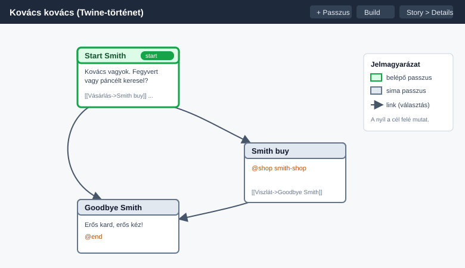
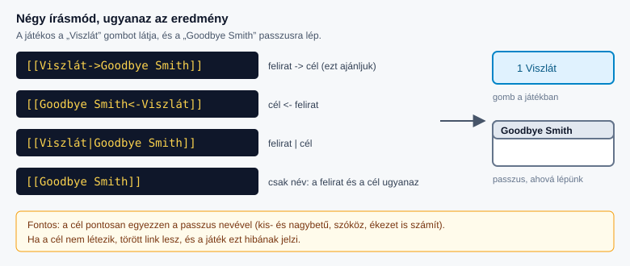
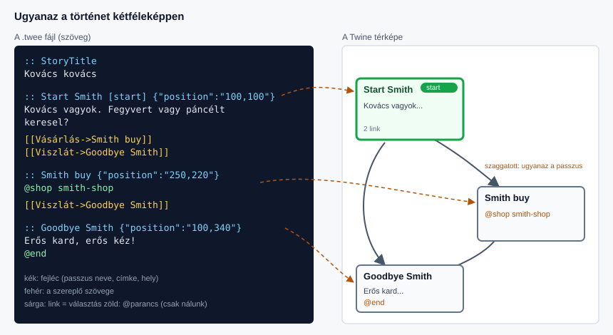

# Twine útmutató íróknak

Ez az útmutató annak szól, aki **még sosem használta a Twine-t**, és nem programozó. Végigvezet azon, mi az a Twine, hogyan írsz benne elágazó beszélgetést, és hogyan mented el úgy, hogy a játékunk be tudja olvasni.

A második rész (a [párbeszéd és bolt szerkesztő útmutató](parbeszed-es-bolt-szerkeszto.md)) arról szól, hogyan lesz ebből az NPC-k beszélgetése és boltja a játékban. Először olvasd el ezt az elsőt.

## Tartalom

1. [Mi az a Twine?](#1-mi-az-a-twine)
2. [Mi az a passzus, és hogyan néz ki egy történet?](#2-mi-az-a-passzus-és-hogyan-néz-ki-egy-történet)
3. [Választás írása: a link négy alakja](#3-választás-írása-a-link-négy-alakja)
4. [Végigvezetett példa: a kovács](#4-végigvezetett-példa-a-kovács)
5. [Hogyan néz ki a történet szövegként (Twee)?](#5-hogyan-néz-ki-a-történet-szövegként-twee)
6. [Exportálás Twee fájlba](#6-exportálás-twee-fájlba)
7. [Gyakori hibák](#7-gyakori-hibák)

---

## 1. Mi az a Twine?

A **Twine** egy ingyenes program elágazó történetek írására. Weboldalon is használható, és letölthető asztali programként is (Windows, Mac, Linux). A hivatalos oldala: <https://twinery.org>.

Ez az útmutató a **Twine 2.6 vagy újabb** változatra készült. Ha az oldalon a „2.6” vagy újabb számot látod, jó helyen jársz.

A Twine-ban a történet **passzusokból** áll, amelyeket **linkek** kötnek össze. Egy passzus egy kis szövegdoboz: ezt mondja most a szereplő. A linkek a választási lehetőségek: ha a játékos az egyiket választja, a történet egy másik passzusra ugrik.

Nálunk egy ilyen Twine-történet **egy párbeszéd-könyvtár**: több NPC beszélgetése lehet egyetlen történetben.

> A Twine felülete angol nyelvű, ezért az útmutatóban a gombok és menük angol nevét írjuk (például **Build**, **Export As Twee**). Mellé magyarul is leírjuk, mit csinálnak.

## 2. Mi az a passzus, és hogyan néz ki egy történet?

### A passzus

A **passzus** (angolul *passage*) a történet egy darabja: van **neve**, van **szövege**, és lehetnek benne **linkek**. A mi játékunkban egy passzus általában azt jelenti: *„ezt mondja most az NPC, és ezeket válaszolhatod rá”*.

Egy passzus így néz ki a Twine térképén:

- fent a **neve** (például `Start Smith`),
- alatta a szöveg első sora (előnézet),
- ha van **címkéje** (tag), az színes sávként látszik.

### A térkép

Amikor megnyitsz egy történetet, a Twine egy **térképet** mutat: minden passzus egy doboz, a linkeket **nyilak** kötik össze. A nyíl a cél felé mutat. A dobozokat szabadon húzogathatod, a sorrendjük nem számít, csak a nyilak.



Néhány dolog, ami a térképen látszik:

- A **zöld keretes** doboz a **kezdő passzus**. A Twine-ban ezt a passzust kell kijelölni a történet indításához (a **Passage** menüben a **Start Story Here** a zöld rakétát teszi rá). A mi játékunk ezt **figyelmen kívül hagyja**, nálunk a belépő passzusokat a nevük vagy a címkéjük jelöli (lásd a második részben).
- Ha egy nyíl **önmagába** vagy egy **korábbi** passzusba mutat, az visszalépést jelent (például „Kérdeznék mást”).
- Ha egy link olyan passzusra mutat, ami nem létezik, a Twine ezt külön jelöli a térképen (törött link).

### Alapműveletek a Twine-ban

1. **Új történet:** a nyitóképernyőn (a **Library**) kattints a **+ New** gombra, adj nevet a történetnek.
2. **Új passzus:** a történet nézetében a **Passage** fül **+ New** gombja. Az új passzus neve először `Untitled Passage`.
3. **Passzus szerkesztése:** kattints duplán a dobozra. Jobb oldalon kinyílik a szerkesztő: itt írod a szöveget.
4. **Átnevezés:** a szerkesztő ablakban a **Rename** gombbal. A Twine az átnevezéskor a rá mutató linkeket is javítja.
5. **Címke (tag):** a szerkesztő ablakban a **+ Tag** gombbal. Nálunk a `start` címke fontos (lásd a második részben).
6. **Mentés:** a Twine **magától ment**, minden változtatás azonnal elmentődik. Az asztali programban a gépeden, a webes változatban a böngésződben.

A Twine-nak sok további lehetősége van (változók, feltételek, színezés). **Ezekre nincs szükséged**, és a játékunk nem is értelmezi őket. Elég a szöveg és a linkek.

## 3. Választás írása: a link négy alakja

A választás a Twine-ban egy **link**: dupla szögletes zárójelek közé írt szöveg. Négy alakja van, mindegyik ugyanazt csinálja:

| Írásmód | Jelentése |
|---|---|
| `[[Viszlát->Goodbye Smith]]` | **felirat -> cél**: a gomb felirata „Viszlát”, a cél a „Goodbye Smith” passzus. **Ezt ajánljuk**, mert a nyíl irányából rögtön látszik, mi a cél. |
| `[[Goodbye Smith<-Viszlát]]` | **cél <- felirat**: ugyanaz, fordított sorrendben. |
| `[[Viszlát\|Goodbye Smith]]` | **felirat \| cél**: ugyanaz egy függőleges vonallal. |
| `[[Goodbye Smith]]` | **csak név**: a felirat és a cél ugyanaz, vagyis a gombon is a „Goodbye Smith” áll. |



Hogyan működik?

- A link **felirata** az, amit a játékos lát a gombon. Bármi lehet: `Vásárlás`, `Kérdeznék mást`, `Köszönöm, viszlát!`.
- A link **célja** annak a passzusnak a **pontos neve**, ahová lépni szeretnél.
- Ha olyan passzusra mutatsz, ami még nincs, a Twine **magától létrehoz egy üres passzust** ezen a néven, amint befejezed a gépelést. Így a történetet úgy is írhatod, hogy a linkeket gépeled, és a Twine felrajzolja a dobozokat.
- A link kerül ki a szövegből. Ha egy sorban csak egy link áll, az a sor eltűnik a szövegből, és gombbá válik.

**Tipp:** a magyar felirat és az angol (vagy egyszerű) passzusnév keverése teljesen rendben van. A felirat azt mutatja, amit a játékos lát, a passzusnév csak a te belső azonosítód.

## 4. Végigvezetett példa: a kovács

Írjunk egy rövid beszélgetést egy kovácsról. Három passzust készítünk.

**1. lépés: a belépő passzus.** Hozz létre egy passzust, nevezd el `Start Smith`-nek, és írd bele:

```
Kovács vagyok. Fegyvert vagy páncélt keresel?

[[Vásárlás->Smith buy]]
[[Viszlát->Goodbye Smith]]
```

Amint kiírtad a második link végén a `]]` jelet, a Twine két új passzust rajzol a térképre: `Smith buy` és `Goodbye Smith`, mindkettő üres.

**2. lépés: a vásárlás passzus.** Kattints duplán a `Smith buy`-ra, és írd bele:

```
Nézd meg, mit tudok adni.

[[Viszlát->Goodbye Smith]]
```

A `Goodbye Smith` már létezik, ezért ide a Twine nem hoz létre újat, csak egy új nyilat rajzol.

**3. lépés: a búcsú passzus.** Kattints duplán a `Goodbye Smith`-re:

```
Erős kard, erős kéz!
```

(A második részben megtanulod, hogyan zárja be a játék a beszélgetést és hogyan nyit boltot: ehhez egy-egy `@` jelű sort kell még beírnod. Ez a Twine-ban egyszerű szövegnek látszik, a játék viszont parancsként érti.)

**4. lépés: ellenőrzés.** Nézd meg a térképet: három doboz van, a `Start Smith`-ből két nyíl indul, a `Smith buy`-ból egy. Ha egy passzus „árván” áll nyilak nélkül, valószínűleg elgépeltél egy nevet.

**5. lépés: próbálgatás.** A **Build** fülön a **Play** gombbal a böngészőben végigkattinthatod a történetet. Nálunk a végső teszt a játék szerkesztőjének tesztablakában lesz, de a Twine saját lejátszása is jó arra, hogy lásd, hogy minden link jó helyre visz.

## 5. Hogyan néz ki a történet szövegként (Twee)?

A Twine történeteket **Twee** nevű, egyszerű szöveges formában is el lehet menteni. Ezt a formát a játékunk be tudja olvasni. Pontosabban a **Twee 3** változatot használjuk, a fájl kiterjesztése `.twee`. Egy sima szövegszerkesztővel (Jegyzettömb, VS Code) is megnyitható, és át is írható.

Így néz ki a fenti kovács-történet Twee fájlként:

```
:: StoryTitle
Kovács kovács


:: StoryData
{
  "ifid": "FEDB84A7-5B71-4E3D-BFDC-0297BF45E6C9",
  "format": "Harlowe",
  "format-version": "3.3.9",
  "start": "Start Smith",
  "zoom": 1
}


:: Start Smith [start] {"position":"1450,350","size":"100,100"}
Kovács vagyok. Fegyvert vagy páncélt keresel?

[[Vásárlás->Smith buy]]
[[Viszlát->Goodbye Smith]]


:: Smith buy {"position":"1575,475","size":"100,100"}
Nézd meg, mit tudok adni.

[[Viszlát->Goodbye Smith]]


:: Goodbye Smith {"position":"1450,600","size":"100,100"}
Erős kard, erős kéz!
```

A szabályok egyszerűek:

- Minden passzus egy **fejléc sorral** kezdődik, ami `::` jellel indul: `:: Passzusnév [címke1 címke2] {"position":"..."}`.
- A **passzus neve** a `::` után áll.
- A **címkék** szögletes zárójelben, szóközzel elválasztva. Ha nincs címke, a zárójel el is marad (mint a `Smith buy` esetében).
- A kapcsos zárójeles rész (`{"position":...}`) a doboz **helye a térképen**. Ezt a Twine írja, neked nem kell vele foglalkoznod. Ha kézzel írsz Twee fájlt, ki is hagyhatod.
- A fejléc **alatti sorok** a passzus szövege, a következő `::` sorig.
- A `:: StoryTitle` a történet címe (nálunk a könyvtár neve lesz). A `:: StoryData` technikai adat (a Twine írja, nálunk nem passzus).

### A szöveg és a térkép megfelelése



A kép bal oldalán a szöveg, a jobb oldalán ugyanez a Twine térképen. Minden `::` fejléc egy doboz, minden `[[link]]` egy nyíl.

A játékban a bal oldali szöveget olvassuk be, a térképet nem. Ezért **bármelyik oldalról szerkesztheted** a történetet: a Twine-ban dobozokkal, vagy a fájlban szövegként.

> Ha a fájlt kézzel szerkeszted, ügyelj arra, hogy a szöveg egyik sora se kezdődjön `::` jellel, mert azt a program új passzus fejlécének hiszi.

## 6. Exportálás Twee fájlba

A játék a Twine **Twee exportját** várja. Így készítsd el:

1. Nyisd meg a történetet a Twine-ban (a szerkesztőnézetben, a térkép előtt).
2. Kattints felül a **Build** fülre.
3. Válaszd az **Export As Twee** gombot.
4. A Twine letölt egy `.twee` fájlt. A böngészős változat a letöltések mappába teszi, az asztali program megkérdezi, hova mentsd.
5. Adj a fájlnak beszédes, egyszerű nevet, például `void-fantasy.twee`. **A fájlnévből lesz a könyvtár azonosítója** a játékban, ezért kerüld az ékezeteket és a szóközöket (az azonosító a fájlnévből készül: kisbetűs lesz, az ékezetek elmaradnak, minden más jel kötőjellé válik).

Ugyanezen a fülön látod a **Publish to File** gombot is, ami weboldalnak való HTML-t ad. **Az nem jó nekünk**, mi a **Twee** formát használjuk.

Ha később javítasz a történeten, exportálj újra, és importáld újra a szerkesztőben (az azonos nevű fájl lecseréli a régi könyvtárat, lásd a második részben).

**Más történet-formátum:** a Twine-ban a történet formátuma (Harlowe, SugarCube stb.) a **Story** fül **Details** pontjában állítható. Nálunk **mindegy**, melyiket használod, mert a formátum saját makróit (például `(set: ...)`) a játék nem értelmezi: azok sima szövegként maradnának. **Ne használj ilyeneket.**

## 7. Gyakori hibák

| Hiba | Mi történik | Mit csinálj |
|---|---|---|
| **Két passzus azonos névvel** | A Twine nem engedi, de kézzel összefésült fájlban előfordul. A játék ezt **hibaként** jelzi. | Nevezd át az egyiket, és javítsd a rá mutató linkeket. |
| **Link olyan passzusra, ami nincs** („törött link”) | A választás nem működik, a játék ezt **hibaként** jelzi. | Javítsd a nevet a linkben, vagy hozd létre a passzust. |
| **Elgépelt link-cél** | A Twine ilyenkor **új, üres passzust** hoz létre az elgépelt néven, ami „árván” marad. | Javítsd a linket, és töröld a felesleges üres passzust. |
| **Nagybetű, szóköz, ékezet eltérés** (`goodbye smith` ≠ `Goodbye Smith`) | A nevek **pontosan** számítanak, ez törött link lesz. | Másold a pontos nevet a passzusból. |
| **A link `->`, `<-` vagy `\|` jelet tartalmaz a nevében vagy feliratában** | A program rossz helyen vágja ketté a linket. | Ne használd ezeket a jeleket a névben és a feliratban. |
| **Üres `Untitled Passage` maradt** | A játék figyelmen kívül hagyja (nincs hiba), de zavaró. | Töröld, vagy írj bele. |
| **Elfelejtett `start` címke vagy `Start` név** | A játék nem tudja, hol kezdődik a beszélgetés. Hibát jelez. | Lásd a második részt. |
| **Twine makrók (`(if: ...)`, `<<set ...>>`)** | Szövegként jelennek meg. | Ne használd őket. |
| **A szöveg egy sora `@` jellel kezdődik** | Nálunk ez parancs, és kikerül a szövegből. | Ne kezdj `@` jellel sort, ha nem parancsot akarsz. |

### Jó szokások

- **Rövid, egyszerű passzusnevek**, szóközzel vagy anélkül: `Start Smith`, `Smith buy`, `Goodbye Smith`. Gondolj arra, hogy a neveket később egy listában fogod látni.
- **Egy passzus = egy megszólalás.** Ha sok szöveg van, tedd több passzusba.
- **Minden ágnak legyen vége**: egy „Goodbye” jellegű passzus, amit a második részben tanulsz meg lezárni.
- **Gyakran ments és exportálj** egy biztonsági másolatot a `.twee` fájlból.

---

Tovább a második részre: [párbeszéd és bolt szerkesztő útmutató](parbeszed-es-bolt-szerkeszto.md).
